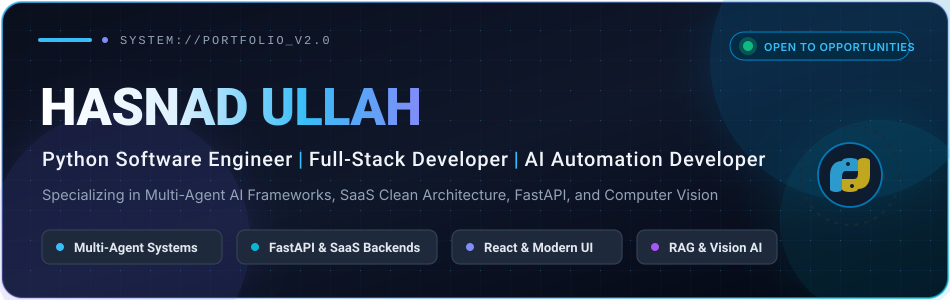

<div align="center">

  <!-- Header Banner -->
  

  <br/><br/>

  <!-- Dynamic Typing SVG Headline -->
  <a href="https://github.com/hasnadullah">
    
  </a>

  <br/>

  <!-- Quick Badges / Meta -->
  <p>
    <a href="https://github.com/hasnadullah"></a>
    
    
    <a href="https://hasnad-ullah-portfolio.netlify.app/"></a>
  </p>

  <!-- Social & Connect Buttons -->
  <p>
    <a href="https://www.linkedin.com/in/hasnad-ullah-42648a268/" target="_blank">
      
    </a>
    <a href="mailto:hasnadk676@gmail.com">
      
    </a>
    <a href="https://hasnad-ullah-portfolio.netlify.app/" target="_blank">
      
    </a>
    <a href="https://github.com/hasnadullah">
      
    </a>
  </p>

</div>

---

### 👨‍💻 About Me

I am a software developer with approximately one year of hands-on experience across **Python development**, **full-stack applications**, **REST APIs**, **backend architecture**, **AI integrations**, **computer vision**, and **business process automation**.

I enjoy building practical software solutions that solve real-world problems, improve workflows, and connect AI capabilities with useful applications.

```yaml
summary:
  name: "Hasnad Ullah"
  roles:
    - "Python Software Engineer"
    - "Full-Stack Developer"
    - "AI Automation Developer"
  education:
    degree: "BS Artificial Intelligence"
    institution: "University of Wah"
    graduation_year: 2025
    cgpa: "3.21 / 4.00"
  core_focus:
    - "Autonomous Multi-Agent AI Frameworks (CrewAI)"
    - "High-Performance REST APIs & SaaS Architectures (FastAPI)"
    - "Full-Stack Applications (React / Next.js / TypeScript)"
    - "Local RAG & LLM Integration (LangChain / Ollama)"
    - "Workflow Automation & Webhook Pipelines (n8n / Python)"
```

- 🔭 **Currently Building:** High-concurrency SaaS backend architectures and autonomous multi-agent developer workflows.
- 💡 **Engineering Philosophy:** Clean Architecture, strictly typed domain schemas, modular design patterns, and observable APIs.
- 🎯 **Looking to Collaborate On:** Open-source AI tools, workflow automation engines, and production full-stack systems.

---

### 🛠️ Technical Skills & Tech Stack

<table>
  <tr>
    <td width="24%"><b>Programming</b></td>
    <td>
      
      
      
      
    </td>
  </tr>
  <tr>
    <td><b>Backend &amp; APIs</b></td>
    <td>
      
      
      
      
      
    </td>
  </tr>
  <tr>
    <td><b>Frontend</b></td>
    <td>
      
      
      
      
      
    </td>
  </tr>
  <tr>
    <td><b>Databases &amp; Caching</b></td>
    <td>
      
      
      
      
    </td>
  </tr>
  <tr>
    <td><b>AI &amp; Machine Learning</b></td>
    <td>
      
      
      
      
      
      
    </td>
  </tr>
  <tr>
    <td><b>Automation &amp; Integrations</b></td>
    <td>
      
      
      
      
    </td>
  </tr>
  <tr>
    <td><b>DevOps &amp; Tooling</b></td>
    <td>
      
      
      
      
      
    </td>
  </tr>
</table>

---

### 🚀 Featured Repositories & Open Source Work

Here are verified key projects showcasing software architecture, multi-agent AI, and clean backend design:

<table>
  <tr>
    <td width="50%" valign="top">
      <h3>🤖 <a href="https://github.com/hasnadullah/AutoSysDesign_CrewAI">AutoSysDesign_CrewAI</a></h3>
      <p><b>Collaborative Multi-Agent AI System Design Framework</b></p>
      <p>An autonomous multi-agent pipeline that transforms informal user requirements into structured technical specifications, architectural blueprints, risk analyses, pseudo-code, and automated test plans.</p>
      <p>
        <b>Tech Stack:</b> <code>CrewAI</code> • <code>Python</code> • <code>LangChain</code> • <code>FastAPI</code> • <code>React</code><br/>
        <b>Key Solution:</b> Replaces manual software design bottlenecks with synchronized multi-agent planning roles (Architect, Security, QA).
      </p>
      <a href="https://github.com/hasnadullah/AutoSysDesign_CrewAI">
        
      </a>
    </td>
    <td width="50%" valign="top">
      <h3>🏢 <a href="https://github.com/hasnadullah/Multi-Tenant-System">Multi-Tenant-System</a></h3>
      <p><b>Enterprise SaaS Multi-Tenant Architecture</b></p>
      <p>Production-ready multi-tenant system implementation for Software-as-a-Service platforms built with strict Clean Architecture principles, tenant data isolation, and modular services.</p>
      <p>
        <b>Tech Stack:</b> <code>Python</code> • <code>FastAPI</code> • <code>Clean Architecture</code> • <code>PostgreSQL</code> • <code>MongoDB</code><br/>
        <b>Key Solution:</b> Implements secure data partitioning and tenant scoping across relational and document database drivers.
      </p>
      <a href="https://github.com/hasnadullah/Multi-Tenant-System">
        
      </a>
    </td>
  </tr>
  <tr>
    <td width="50%" valign="top">
      <h3>💬 <a href="https://github.com/hasnadullah/Resturant-review-project">Resturant-review-project</a></h3>
      <p><b>Local Privacy-First AI Restaurant Assistant &amp; RAG Analyzer</b></p>
      <p>Conversational assistant utilizing local Large Language Models and vector embeddings to extract actionable sentiment, answer user queries, and analyze restaurant reviews with zero external cloud dependencies.</p>
      <p>
        <b>Tech Stack:</b> <code>LangChain</code> • <code>Ollama</code> • <code>RAG</code> • <code>ChromaDB</code> • <code>Python</code><br/>
        <b>Key Solution:</b> 100% offline retrieval-augmented generation ensuring complete privacy and fast local inference.
      </p>
      <a href="https://github.com/hasnadullah/Resturant-review-project">
        
      </a>
    </td>
    <td width="50%" valign="top">
      <h3>📋 <a href="https://github.com/hasnadullah/TaskTracker">TaskTracker</a></h3>
      <p><b>Assignment &amp; Task Workflow Platform with Mentor Feedback</b></p>
      <p>Full-stack assignment tracking portal designed for structured team and internship management, enabling tasks to be logged, submitted, reviewed, and given granular feedback by mentors.</p>
      <p>
        <b>Tech Stack:</b> <code>Python</code> • <code>REST APIs</code> • <code>Role-Based Access Control</code> • <code>Workflow Management</code><br/>
        <b>Key Solution:</b> Eliminates disconnected email reviews by unifying task lifecycle management and feedback on one platform.
      </p>
      <a href="https://github.com/hasnadullah/TaskTracker">
        
      </a>
    </td>
  </tr>
  <tr>
    <td width="50%" valign="top">
      <h3>⚡ <a href="https://github.com/hasnadullah/FastAPI-mongoDB-JWT-MVC">FastAPI-mongoDB-JWT-MVC</a></h3>
      <p><b>FastAPI MVC Backend Template with MongoDB &amp; JWT</b></p>
      <p>A structured Model-View-Controller backend architecture blueprint utilizing FastAPI, async MongoDB drivers, Pydantic data validation schemas, and secure JWT-based bearer authentication.</p>
      <p>
        <b>Tech Stack:</b> <code>FastAPI</code> • <code>MongoDB</code> • <code>Pydantic</code> • <code>JWT</code> • <code>MVC Pattern</code><br/>
        <b>Key Solution:</b> Standardizes enterprise folder structure and controller separation for rapid API prototyping.
      </p>
      <a href="https://github.com/hasnadullah/FastAPI-mongoDB-JWT-MVC">
        
      </a>
    </td>
    <td width="50%" valign="top">
      <h3>👁️ <a href="https://github.com/hasnadullah/DoNut_Diameter-">Computer Vision &amp; Image Processing</a></h3>
      <p><b>Automated Diameter Inspection &amp; Facial Recognition</b></p>
      <p>Computer vision applications covering precision geometric measurement algorithms (<a href="https://github.com/hasnadullah/DoNut_Diameter-">DoNut_Diameter-</a>) and real-time facial feature extraction (<a href="https://github.com/hasnadullah/FacialRecognition">FacialRecognition</a>).</p>
      <p>
        <b>Tech Stack:</b> <code>Python</code> • <code>OpenCV</code> • <code>NumPy</code> • <code>Feature Detection</code><br/>
        <b>Key Solution:</b> Implements edge-detection, contour modeling, and image transformation pipelines for automated visual inspection.
      </p>
      <a href="https://github.com/hasnadullah/DoNut_Diameter-">
        
      </a>
    </td>
  </tr>
</table>

---

### 💼 Professional Journey & Experience

Accurate record of professional roles and industry internship engagements:

- **Full-Stack Web & AI Developer Intern** — **Troon Technologies** *(~6 Months)*
  - Developed full-stack web applications, RESTful microservices, and AI-enabled software features.
- **Project-Based Contract Engagement** — **Systems Limited** *(~4 Months)*
  - Delivered focused client software components, API integrations, and backend workflow tasks.
- **Machine Learning & AI Intern** — **PD Labs** *(~2 Months)*
  - Implemented machine learning experiments, data preprocessing, and model evaluations.
- **AI Intern** — **Shahzad Adil & Co** *(~2 Months)*
  - Explored automation workflows, data analytics, and intelligent business process optimization.

---

### 🎓 Education & Certifications

- 🎓 **Bachelor of Science in Artificial Intelligence (BS AI)**
  - **Institution:** University of Wah
  - **Graduation Year:** 2025
  - **CGPA:** 3.21 / 4.00

- ☁️ **Cloud Architecture:**
  - **AWS Solutions Architect Associate:** Completed comprehensive architectural training and curriculum covering scalable cloud design, VPC networking, EC2/ECS containerization, S3 storage architectures, IAM security, and resilient database configurations *(Official verification available upon request)*.

---

### 📊 GitHub Activity & Statistics

<div align="center">

  <table border="0">
    <tr>
      <td align="center" width="50%">
        
      </td>
      <td align="center" width="50%">
        
      </td>
    </tr>
    <tr>
      <td colspan="2" align="center">
        <br/>
        
      </td>
    </tr>
  </table>

</div>

---

### 🐍 Contribution Activity

<div align="center">
  <picture>
    <source media="(prefers-color-scheme: dark)" srcset="https://raw.githubusercontent.com/hasnadullah/hasnadullah/output/github-contribution-grid-snake-dark.svg">
    <source media="(prefers-color-scheme: light)" srcset="https://raw.githubusercontent.com/hasnadullah/hasnadullah/output/github-contribution-grid-snake.svg">
    
  </picture>
</div>

> [!NOTE]
> The contribution snake above updates automatically every 24 hours via [GitHub Actions](.github/workflows/snake.yml).

---

### 🤝 Let's Connect & Collaborate

I am always interested in discussing software engineering opportunities, AI automation projects, SaaS architecture, or innovative developer tooling.

<div align="center">

  <p>
    <a href="https://www.linkedin.com/in/hasnad-ullah-42648a268/" target="_blank">
      
    </a>
    &nbsp;&nbsp;
    <a href="mailto:hasnadk676@gmail.com">
      
    </a>
    &nbsp;&nbsp;
    <a href="https://hasnad-ullah-portfolio.netlify.app/" target="_blank">
      
    </a>
  </p>

  <p><i>"Passionate about turning complex real-world workflows into elegant, automated software."</i></p>

</div>
